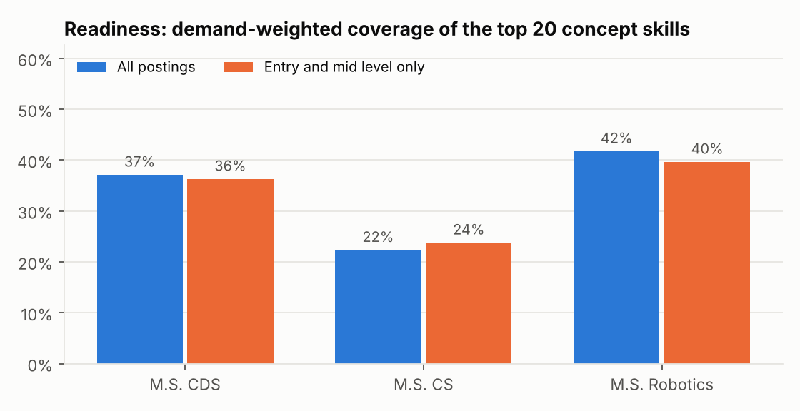
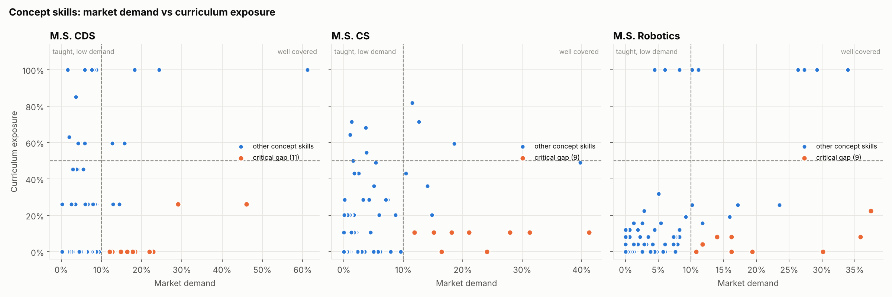

# UCR Skill Gap

**Do UC Riverside's M.S. programs teach what employers are hiring for?**

This project compares the skills requested in real, current job postings against the
course catalogs of three UCR graduate programs, and measures where each curriculum
matches the market and where it falls short.

| Program | Compared against |
|---|---|
| M.S. Computational Data Science | data scientist, ML engineer, data engineer, AI engineer roles |
| M.S. Computer Science | software, backend, platform, distributed systems roles |
| M.S. Robotics | robotics, autonomy, perception, controls, embedded roles |

> **Status:** pipeline complete and tested (51 tests). Extraction accuracy measurement and a live
> dashboard are next. Full results: [`outputs/report.md`](outputs/report.md).

## Findings (snapshot of Nov 13 2026: 2,737 postings from 54 employers)



- **Readiness** (demand-weighted coverage of each program's top 20 concept skills): Robotics 42%,
  CDS 37%, CS 22%. CS is lowest because no single course is required of every student, so every
  topic depends on electives.
- **M.S. CDS:** experimentation and A/B testing (23% of data science postings), model evaluation (22%),
  and data pipelines (18%) appear in no course description. LLMs are in 46% of postings but only one
  elective (EE 269) covers them.
- **M.S. CS:** backend development (41% of software postings), APIs (31%), and site reliability
  engineering (24%) are the largest gaps.
- **M.S. Robotics:** safety-critical systems (30% of robotics postings), hardware testing and validation
  (19%), and embedded systems (36% vs 8% exposure) are the largest gaps. Motion planning, state
  estimation, perception, and simulation are well covered.



## Data

**Job postings, collected daily by GitHub Actions** ([`daily-collect`](.github/workflows/daily-collect.yml))
- **Company career boards** (Greenhouse, Lever, Ashby public APIs): full posting text from ~55 employers
  including Waymo, Zoox, Nuro, Anduril, OpenAI, Anthropic, Databricks, and Stripe. Used for skill extraction.
- **Adzuna API**: market-wide postings for 19 job titles. Adzuna returns only the first 500 characters of
  each description, so it is used for role volume and salary context, not for skills.
- Each posting is stored once, on the day it first appears. `last_seen` dates track when postings close.
  Browse what is open right now in [`data/history/open_board_postings.csv`](data/history/open_board_postings.csv).

**Curriculum** ([`data/raw/2026-11-06-ucr-ms-curriculum.csv`](data/raw/2026-11-06-ucr-ms-curriculum.csv))
- 176 courses across the three programs, scraped from the 2025-26 UCR General Catalog, with official
  descriptions, credits, core/elective status, and 2025-26 enrollment.
- A test checks every course code named in the catalog's program requirements is present.

## Method

1. **Cleaning** ([`skillgap/clean.py`](skillgap/clean.py)). Drops non-engineering roles that matched on
   keywords (product managers, technical writers), student and contract roles, and caps each employer at
   10% of a role family so a few large employers cannot dominate. Removes company boilerplate by deleting
   sentences repeated across a company's postings (43% of all text was boilerplate).
2. **Skill taxonomy** ([`skillgap/taxonomy.py`](skillgap/taxonomy.py)). 137 skills in 10 categories with
   ~700 aliases, built by measuring candidate terms against the cleaned postings.
3. **Extraction** ([`skillgap/extract.py`](skillgap/extract.py)). Boundary-aware, longest-match-first
   matching with case-sensitive aliases for ambiguous words. Naive substring matching would report Rust in
   53% of postings (it matches "trust") and Scala in 42% ("scalable"). TF-IDF n-gram discovery lists
   frequent terms the taxonomy misses, for review.
4. **Gap scoring** ([`skillgap/gap.py`](skillgap/gap.py)). *Demand* is the share of a role family's postings
   that mention a skill. *Exposure* is the probability a graduate took at least one course whose catalog
   description covers it: core courses count 1.0, "pick one" courses 1/n, electives (slots / pool size).
   Scored twice: all postings, and entry plus mid level only.
5. **Concepts vs tools.** Catalog descriptions name concepts ("relational data model"), not tools
   ("PostgreSQL"). So only concept skills get a gap score. Tools (Python, PyTorch, AWS) and practices
   (debugging, code review) are reported as market demand only, instead of being shown as false gaps.

## Limitations

- Exposure is a lower bound: a course can teach a concept its short catalog description does not name.
- Electives are modeled as a uniform choice. Real students cluster in popular electives.
- Career boards over-represent tech companies and funded startups. Robotics has the smallest sample (315).

## Run it

```bash
pip install pandas scikit-learn openpyxl pytest
python -m pytest            # 51 tests
python -m skillgap run      # writes outputs/report.md, CSVs, and charts
python -m skillgap discover --family robotics   # terms the taxonomy does not cover yet
```
