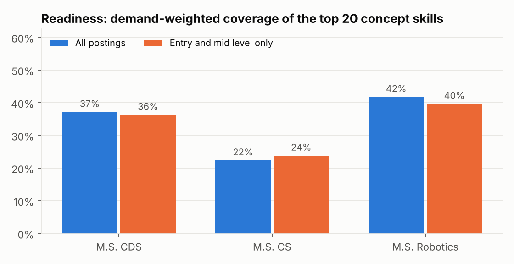
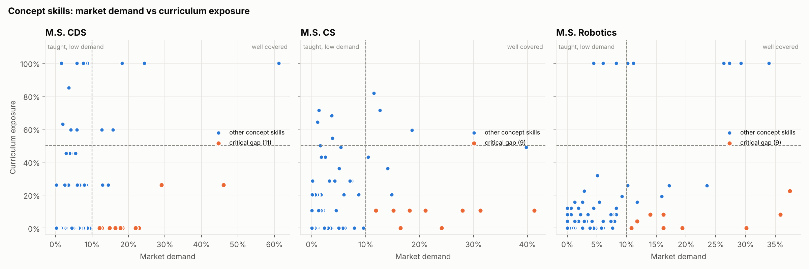
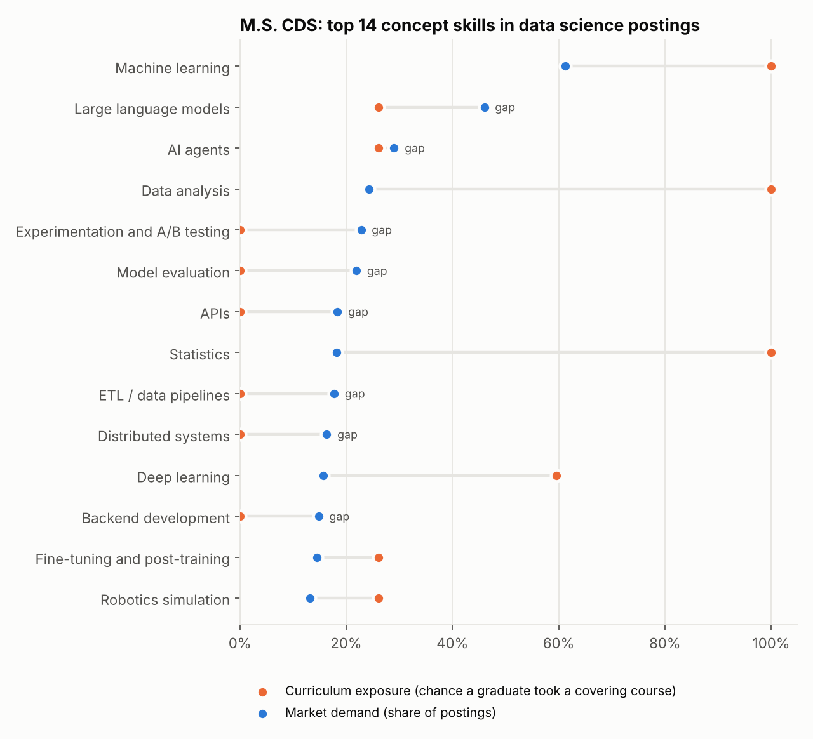
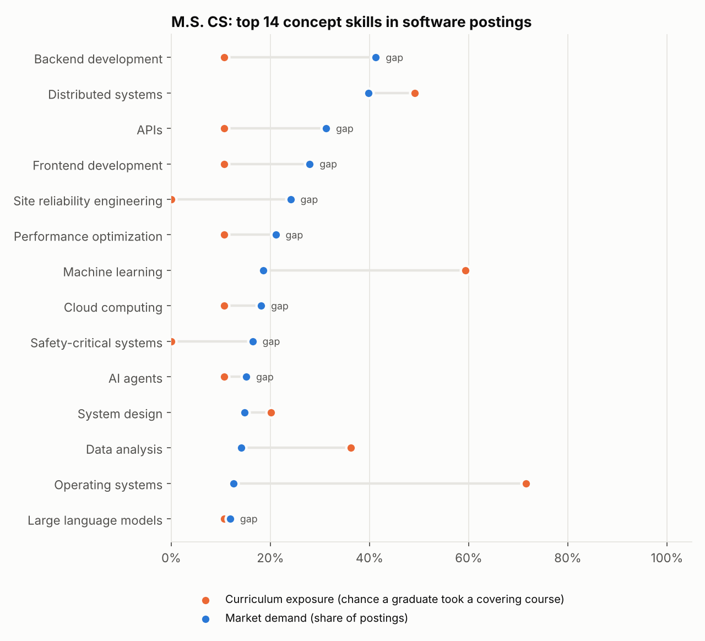
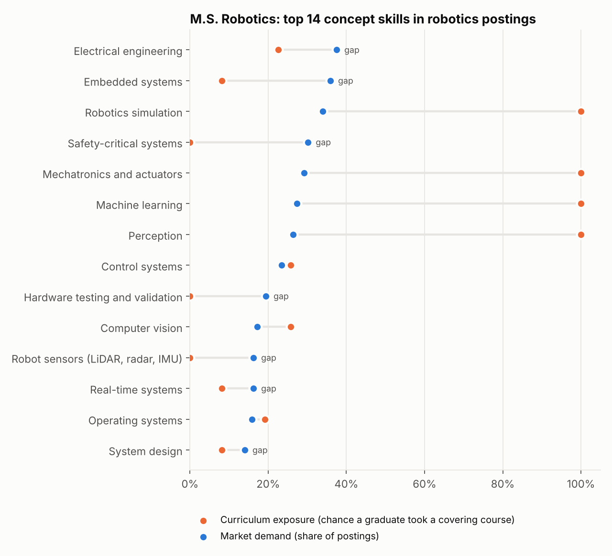
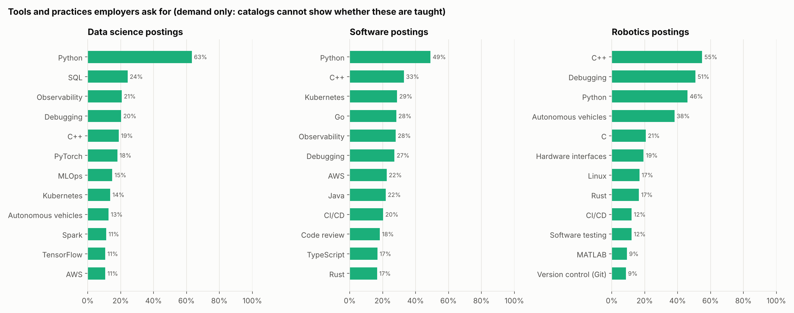
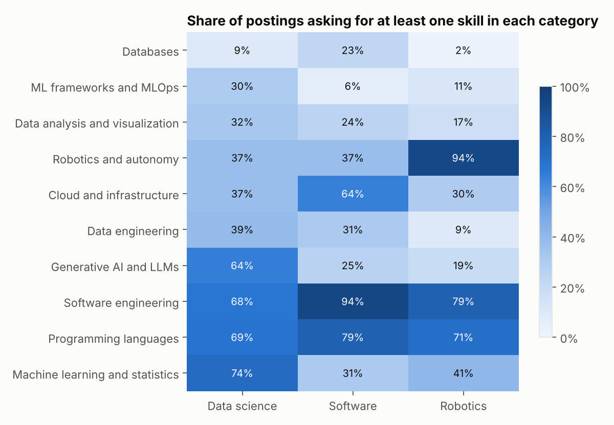
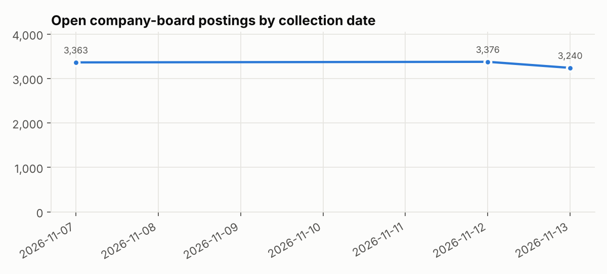

# Skill gap report (2026-11-13)

Postings analyzed: **2,737** open company-board postings (789 data science, 1,633 software, 315 robotics) from 54 employers, after cleaning 3,240 open postings. Curriculum: 176 courses from the 2025-26 UCR catalog.

**How to read this.** *Demand* is the share of a role family's postings that mention a skill. *Exposure* is the chance a typical graduate took at least one course whose catalog description covers it. A **critical gap** is a concept in at least 10% of postings that fewer than half of graduates are likely to have studied. Tools and practices are reported as demand only, because catalog descriptions do not list the tools a course uses.

## Readiness

| Program | All postings | Entry and mid level |
|---|---|---|
| M.S. CDS | 37% | 36% |
| M.S. CS | 22% | 24% |
| M.S. Robotics | 42% | 40% |

## Critical gaps by program

### M.S. CDS

**All postings**

| Skill | Demand | Exposure | Covering courses |
|---|---|---|---|
| Experimentation and A/B testing | 23% | 0% | none |
| Model evaluation | 22% | 0% | none |
| Large language models | 46% | 26% | EE 269 |
| APIs | 18% | 0% | none |
| ETL / data pipelines | 18% | 0% | none |
| Distributed systems | 16% | 0% | none |
| Backend development | 15% | 0% | none |
| Generative AI | 13% | 0% | none |

**Entry and mid level**

| Skill | Demand | Exposure | Covering courses |
|---|---|---|---|
| Model evaluation | 21% | 0% | none |
| APIs | 21% | 0% | none |
| ETL / data pipelines | 20% | 0% | none |
| Experimentation and A/B testing | 19% | 0% | none |
| Backend development | 16% | 0% | none |
| Large language models | 42% | 26% | EE 269 |
| Distributed systems | 15% | 0% | none |
| Safety-critical systems | 14% | 0% | none |

Well covered: Machine learning, Deep learning, Reinforcement learning, Data analysis, Statistics.

### M.S. CS

**All postings**

| Skill | Demand | Exposure | Covering courses |
|---|---|---|---|
| Backend development | 41% | 11% | CS 110 |
| Site reliability engineering | 24% | 0% | none |
| APIs | 31% | 11% | CS 167 |
| Frontend development | 28% | 11% | CS 110 |
| Safety-critical systems | 16% | 0% | none |
| Performance optimization | 21% | 11% | CS 211 |
| Cloud computing | 18% | 11% | CS 208 |
| AI agents | 15% | 11% | CS 258 |

**Entry and mid level**

| Skill | Demand | Exposure | Covering courses |
|---|---|---|---|
| Backend development | 41% | 11% | CS 110 |
| Frontend development | 34% | 11% | CS 110 |
| APIs | 32% | 11% | CS 167 |
| Site reliability engineering | 21% | 0% | none |
| Safety-critical systems | 18% | 0% | none |
| Performance optimization | 21% | 11% | CS 211 |
| Cloud computing | 18% | 11% | CS 208 |
| AI agents | 11% | 11% | CS 258 |

Well covered: Machine learning, Operating systems, Robotics simulation.

### M.S. Robotics

**All postings**

| Skill | Demand | Exposure | Covering courses |
|---|---|---|---|
| Safety-critical systems | 30% | 0% | none |
| Embedded systems | 36% | 8% | EE 128, ME 133 |
| Hardware testing and validation | 19% | 0% | none |
| Robot sensors (LiDAR, radar, IMU) | 16% | 0% | none |
| Electrical engineering | 37% | 23% | ME 133, EE 230, EE 286C, EE 221, EE 118, EE 135 |
| Guidance, navigation and control | 11% | 0% | none |
| Real-time systems | 16% | 8% | EE 128, CS 251 |
| Sensor fusion | 12% | 4% | EE 247 |

**Entry and mid level**

| Skill | Demand | Exposure | Covering courses |
|---|---|---|---|
| Embedded systems | 36% | 8% | EE 128, ME 133 |
| Safety-critical systems | 22% | 0% | none |
| Hardware testing and validation | 18% | 0% | none |
| Electrical engineering | 39% | 23% | ME 133, EE 230, EE 286C, EE 221, EE 118, EE 135 |
| Robot sensors (LiDAR, radar, IMU) | 13% | 0% | none |
| Guidance, navigation and control | 13% | 0% | none |
| Real-time systems | 15% | 8% | EE 128, CS 251 |
| System design | 12% | 8% | EE 128, CS 255 |

Well covered: Robotics simulation, Mechatronics and actuators, Machine learning, Perception, Motion planning, State estimation.

## Tools and practices in demand

## Skill categories by role family

## Collection over time

## Limitations

- Exposure comes from catalog descriptions, which are short. A course can teach a concept its description does not name, so exposure is a lower bound.
- Electives use a uniform-choice model (slots / pool size). Real students cluster in popular electives.
- Postings come from ~55 employers on Greenhouse, Lever, and Ashby, which over-represents tech companies and well-funded startups. Each employer is capped at 10% of a role family.
- Robotics has the smallest sample, so its percentages move more between collection days.
